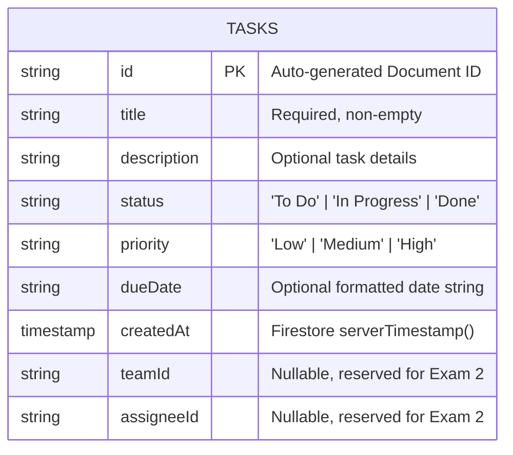

# Task Management Mobile Application (Practical Exam 1)

A cross-platform mobile task management application built with **React Native (Expo)**, **TypeScript**, and **Firebase Cloud Firestore**. Designed for high reliability, real-time synchronization, responsive viewports, and clean modular architecture.

---

## 🏗️ Project Architecture & Folder Structure

```text
task-management-app/
├── .github/
│   └── workflows/
│       └── ci.yml             # GitHub Actions CI for automated type checking
├── assets/                    # Static assets, app icons, and splash screens
├── src/
│   ├── components/            # Reusable UI components
│   │   ├── Header.tsx         # Screen header with title and subtitle
│   │   ├── StatusFilter.tsx   # Filter chip bar with dynamic task count badges
│   │   ├── TaskCard.tsx       # Task card item with priority & status indicators
│   │   └── TaskFormModal.tsx  # Modal form for creating & editing tasks (with validation)
│   ├── hooks/
│   │   └── useTasks.ts        # Custom hook for real-time Firestore sync & CRUD actions
│   ├── navigation/
│   │   └── BottomTabNavigator.tsx # Bottom tab bar (Home, Teams, Profile)
│   ├── screens/
│   │   ├── HomeScreen.tsx     # Main dashboard with task CRUD and filter
│   │   ├── TeamsScreen.tsx    # Coming Soon placeholder (Exam 2)
│   │   └── ProfileScreen.tsx  # Coming Soon placeholder (Exam 2)
│   ├── services/
│   │   ├── firebase.ts        # Modular Firebase initialization
│   │   └── taskService.ts     # Firestore CRUD functions (addDoc, updateDoc, deleteDoc, onSnapshot)
│   ├── styles/
│   │   └── theme.ts           # Centralized color palette, spacing, and typography
│   └── types/
│       └── task.types.ts      # TypeScript interfaces and data models
├── .env.example               # Firebase environment variable mock template
├── .eslintrc.json             # ESLint configuration
├── .prettierrc                # Prettier code formatting rules
├── App.tsx                    # Application entry point with SafeAreaProvider & Navigation
└── package.json
```

---

## 📊 Firestore Data Model (ERD)

The application communicates directly with Google Cloud Firestore in **Test Mode** (no authentication required for Practical Exam 1).

### Schema Diagram



### Document Attributes

| Field | Type | Required | Description |
|---|---|---|---|
| `id` | `string` | Yes | Firestore auto-generated document identifier |
| `title` | `string` | Yes | Short title describing the task |
| `description` | `string` | No | Additional context, subtasks or instructions |
| `status` | `'To Do' \| 'In Progress' \| 'Done'` | Yes | Current task progression |
| `priority` | `'Low' \| 'Medium' \| 'High'` | Yes | Urgency level with UI color coding |
| `dueDate` | `string` | No | Target completion date (e.g. `2026-10-25`) |
| `createdAt` | `Timestamp` | Yes | Server timestamp used for sorting (newest first) |
| `teamId` | `string \| null` | No | Team reference (set to `null` for Exam 1) |
| `assigneeId` | `string \| null` | No | User reference (set to `null` for Exam 1) |

---

## 🚀 Setup & Execution Guide

### Prerequisites
- Node.js (v18 or v20 LTS recommended)
- npm or yarn
- Expo Go app on iOS/Android device OR an Android/iOS emulator

### Installation

1. **Clone the repository:**
   ```bash
   git clone <YOUR_GITHUB_REPOSITORY_URL>
   cd task-management-app
   ```

2. **Install dependencies:**
   ```bash
   npm install
   ```

3. **Configure Firebase:**
   - Copy `.env.example` to `.env`:
     ```bash
     cp .env.example .env
     ```
   - Replace the values in `.env` with your actual Firebase project credentials from [Firebase Console](https://console.firebase.google.com/).

4. **Run the application:**
   ```bash
   npx expo start
   ```
   - Press `a` for Android emulator
   - Press `i` for iOS simulator
   - Scan the QR code using Expo Go app on your physical device

---

## ✨ Features Implemented

1. **Clean Code & Scaffolding:** Typed TypeScript models, ESLint, Prettier, and responsive UI scaling for phones and tablets.
2. **Navigation:** React Navigation Bottom Tabs linking `Tasks`, `Teams` (Coming Soon), and `Profile` (Coming Soon).
3. **Real-Time Synchronization:** Cloud Firestore `onSnapshot` listener ensures that any create, update, or delete reflects immediately across all connected devices without manual page reloads.
4. **Task CRUD Operations:**
   - **Create:** Modal form with title client-side validation.
   - **Read:** Task list sorted by newest first, accompanied by a dynamic status filter chip bar with item counts.
   - **Update:** Pre-filled modal editor for updating task content and status.
   - **Delete:** Deletion with defensive confirmation dialog (`Alert.alert`).
5. **CI/CD Automation:** GitHub Actions CI workflow to run TypeScript compiler verification automatically on every push.
