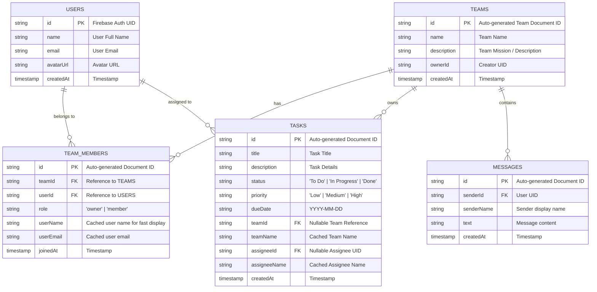

# PRACTICAL EXAM 2 REPORT: AUTHENTICATION, TEAMS & REAL-TIME CHAT
**Course**: Mobile Application Architecture / Development (MMA301)  
**Student Name**: [Your Full Name]  
**Student ID**: [Your Student ID] (e.g. QE123456)  
**Submission File**: StudentID_Exam2.docx  
**Date**: October 13, 2026  

---

## 1. PROJECT LINKS & REPOSITORIES

- **GitHub Public Repository**: [https://github.com/an2obanhmi/MMA_as](https://github.com/an2obanhmi/MMA_as)
- **Expo Project Link / QR Code**: [https://expo.dev/@your-username/task-management-app](https://expo.dev/@your-username/task-management-app)
- **APK Download Link (if built via EAS)**: *Provided upon request*

---

## 2. FIRESTORE DATA MODEL & SCHEMA (EXAM 2)



---

## 3. FIRESTORE SECURITY RULES

```javascript
rules_version = '2';
service cloud.firestore {
  match /databases/{database}/documents {
    
    function isAuthenticated() {
      return request.auth != null;
    }

    match /users/{userId} {
      allow read: if isAuthenticated();
      allow write: if isAuthenticated() && request.auth.uid == userId;
    }

    match /teams/{teamId} {
      allow read, create: if isAuthenticated();
      allow update, delete: if isAuthenticated();
      
      match /messages/{messageId} {
        allow read, write: if isAuthenticated();
      }
    }

    match /teamMembers/{memberId} {
      allow read, write: if isAuthenticated();
    }

    match /tasks/{taskId} {
      allow read, write: if isAuthenticated();
    }
  }
}
```

---

## 4. SCREENSHOT DELIVERABLES & EVIDENCE

### 4.1. Firebase Authentication Console
*Screenshot showing the registered test accounts in Firebase Console > Authentication > Users.*
> **[Insert Screenshot Here: Firebase Auth console with at least 2 test users (e.g. user1@test.com & user2@test.com)]**
*Caption: Demonstrates Firebase Authentication enabled with real user test accounts.*

---

### 4.2. Firestore Database Collections (Console)
*Screenshots showing collections: `users`, `teams`, `teamMembers`, `tasks`, and subcollection `teams/{teamId}/messages`.*
> **[Insert Screenshot Here: Firestore Console showing users and teams collections]**  
> **[Insert Screenshot Here: Firestore Console showing teams/{teamId}/messages and tasks with assignee fields]**
*Caption: Confirms structured data models with relational links and timestamps.*

---

### 4.3. Firestore Security Rules
*Screenshot of the Firebase Console > Firestore Database > Rules tab.*
> **[Insert Screenshot Here: Firestore Rules tab with authentication protection rules]**
*Caption: Shows rules requiring `request.auth != null` for read/write operations.*

---

### 4.4. Sign Up Screen & Login Screen
*Screenshots of the mobile app showing Sign Up and Login screens in Neo-Brutalist styling.*
> **[Insert Screenshot Here: Sign Up Screen with operator form fields]**  
> **[Insert Screenshot Here: Login Screen with error handling or filled credentials]**
*Caption: Authentication gates protecting application entry.*

---

### 4.5. Home Screen (Authenticated)
*Screenshot of the Home screen after successful login showing the task list, status filter, and navigation bar.*
> **[Insert Screenshot Here: Home Screen with tasks]**
*Caption: Protected Home dashboard accessible only to authenticated users.*

---

### 4.6. Teams Screen (Create & Join)
*Screenshot of Teams screen displaying team list, along with Create Team and Join With Code modals.*
> **[Insert Screenshot Here: Teams Screen with established team cards]**  
> **[Insert Screenshot Here: Create Team / Join Modal sheet]**
*Caption: Real collaborative team management replacing Exam 1 placeholder.*

---

### 4.7. Team Detail Screen (Roster & Tasks)
*Screenshot of Team Detail screen displaying team members list and team-specific tasks.*
> **[Insert Screenshot Here: Team Detail screen with Roster tab showing members]**  
> **[Insert Screenshot Here: Team Detail screen with Tasks tab]**
*Caption: Shows team workspace with roster and team-scoped task management.*

---

### 4.8. Task Creation with Team & Assignee Link
*Screenshot of the task creation form with Team and Assignee selected, and the resulting card displaying the assignee name.*
> **[Insert Screenshot Here: Task Form Modal with selected team and assignee]**  
> **[Insert Screenshot Here: TaskCard showing @ASSIGNEE tag and TEAM tag]**
*Caption: Demonstrates task linked to specific team member and team workspace.*

---

### 4.9. Real-Time War Room Chat Screen (2 Users)
*Screenshots showing conversation between at least two different test accounts with timestamps and distinct speech bubbles.*
> **[Insert Screenshot Here: Chat screen from User A's perspective]**  
> **[Insert Screenshot Here: Chat screen from User B's perspective]**
*Caption: Real-time Firestore onSnapshot synchronization between two separate operators in the same team.*

---

### 4.10. Profile Screen & Logout
*Screenshot of the Profile screen showing the authenticated user identity and Logout confirmation returning to Login.*
> **[Insert Screenshot Here: Profile screen with authenticated operator card]**  
> **[Insert Screenshot Here: App redirected to Login screen after logout]**
*Caption: Session termination and security gate re-enforcement.*
